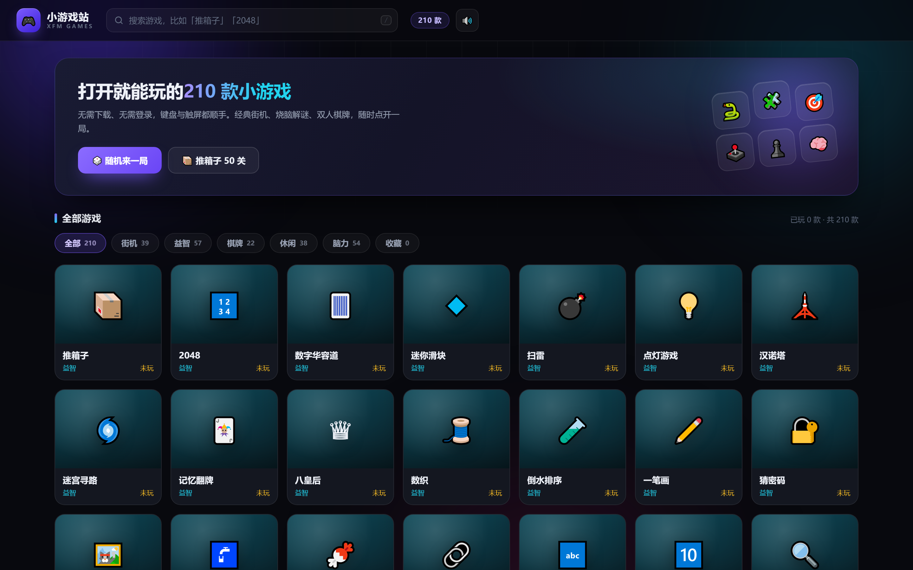
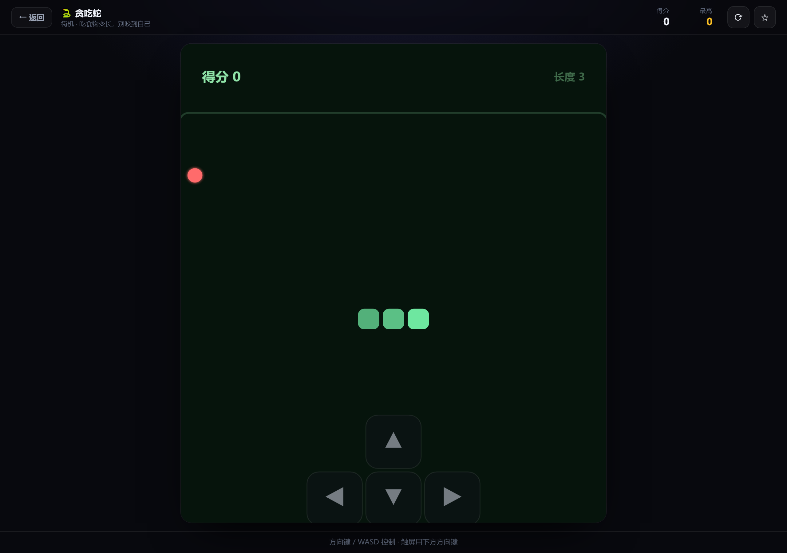
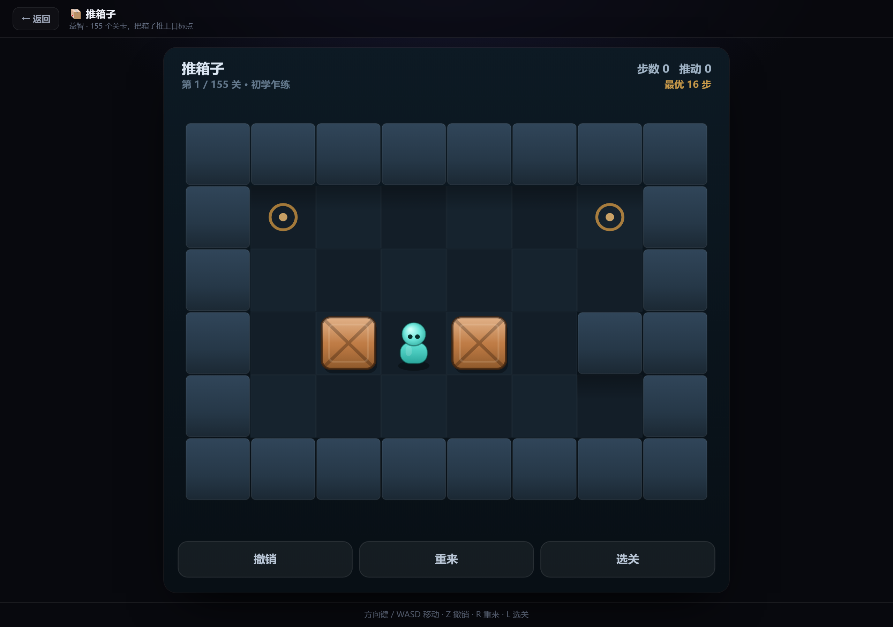
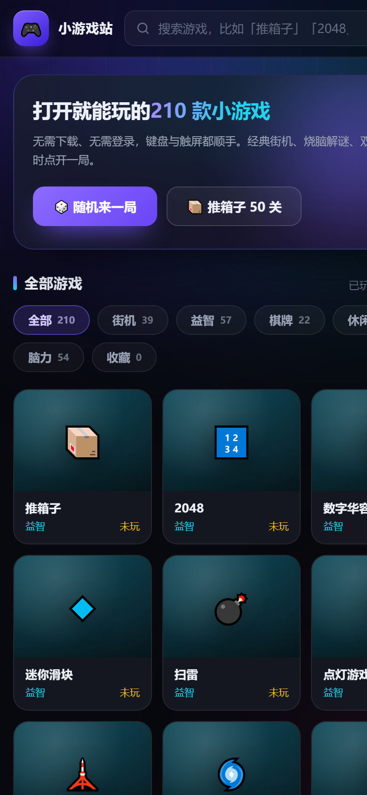

# 🎮 XFM Games · 小游戏站

<p align="center">
  
</p>

> **210 款纯前端小游戏** · 免下载 · 免登录 · 免构建，打开浏览器就能玩
> 在线地址：**[https://game.lovou.pw](https://game.lovou.pw)**

<p align="center">
  
</p>
<p align="center">
  
&nbsp;
  
</p>
<p align="center">
  
</p>

---

## ✨ 特性

- **210 款游戏**，覆盖 5 大分类：街机 / 益智 / 棋牌 / 休闲 / 脑力
- **零依赖**：原生 HTML + CSS + JavaScript，无框架、无构建、无 npm
- **自研 Canvas 游戏引擎**：统一的游戏生命周期、音效（WebAudio 合成）、输入（键盘 + 触屏虚拟方向键）、计分与本地最高分
- **本地存档**：最高分、最近游玩、收藏、音效开关均存 `localStorage`
- **响应式 + 移动端适配**：触屏虚拟方向键，手机也能玩
- **SEO 就绪**：Open Graph、Twitter Card、JSON-LD、canonical、完整 favicon / PWA manifest
- **全文搜索**：按名称 / 描述 / 标签即时过滤，按 `/` 快速聚焦搜索框

## 🚀 本地运行

纯静态站点，任意静态服务器即可：

```bash
# Python
python -m http.server 8080

# 或 Node
npx http-server -p 8080
```

打开 `http://localhost:8080` 即可（直接双击 `index.html` 也能玩）。

## 🕹️ 游戏清单（210 款）

> 点击任意游戏名可直接跳转在线游玩：https://game.lovou.pw

<details open>
<summary><b>🕹️ 街机 · 39 款</b></summary>

| | | | |
| --- | --- | --- | --- |
| [贪吃蛇](https://game.lovou.pw/#/play/snake) | [俄罗斯方块](https://game.lovou.pw/#/play/tetris) | [打砖块](https://game.lovou.pw/#/play/breakout) | [像素鸟](https://game.lovou.pw/#/play/flappy) |
| [乒乓对决](https://game.lovou.pw/#/play/pong) | [太空侵略者](https://game.lovou.pw/#/play/invaders) | [雷电战机](https://game.lovou.pw/#/play/shooter) | [陨石闪避](https://game.lovou.pw/#/play/dodger) |
| [极速跑酷](https://game.lovou.pw/#/play/runner) | [洞穴飞行](https://game.lovou.pw/#/play/cave) | [青蛙过河](https://game.lovou.pw/#/play/frogger) | [小行星](https://game.lovou.pw/#/play/asteroids) |
| [坦克大战](https://game.lovou.pw/#/play/tank) | [极速赛车](https://game.lovou.pw/#/play/racer) | [一飞冲天](https://game.lovou.pw/#/play/doodle) | [钩子摆荡](https://game.lovou.pw/#/play/hook) |
| [迷你高尔夫](https://game.lovou.pw/#/play/golf) | [忍者跳跃](https://game.lovou.pw/#/play/ninja) | [弹珠台](https://game.lovou.pw/#/play/pinball) | [弹幕生存](https://game.lovou.pw/#/play/bulletstorm) |
| [打靶射击](https://game.lovou.pw/#/play/targets) | [陨石躲避](https://game.lovou.pw/#/play/meteor) | [叠叠高](https://game.lovou.pw/#/play/stacker) | [蓄力跳](https://game.lovou.pw/#/play/jumpto) |
| [隧道飞行](https://game.lovou.pw/#/play/tunnel) | [彩砖狂潮](https://game.lovou.pw/#/play/brickx) | [激光冲刺](https://game.lovou.pw/#/play/laserrun) | [环绕突围](https://game.lovou.pw/#/play/orbiter) |
| [旋转护盾](https://game.lovou.pw/#/play/shield) | [月面着陆](https://game.lovou.pw/#/play/lander) | [纸飞机](https://game.lovou.pw/#/play/plane) | [三线疾跑](https://game.lovou.pw/#/play/lanerun) |
| [洞穴直升机](https://game.lovou.pw/#/play/heli) | [反弹球](https://game.lovou.pw/#/play/rally) | [重力翻转](https://game.lovou.pw/#/play/flipgrav) | [黑洞吞噬](https://game.lovou.pw/#/play/blackhole) |
| [炮台防守](https://game.lovou.pw/#/play/turret) | [引力收集](https://game.lovou.pw/#/play/gravitywell) | [墙跳攀登](https://game.lovou.pw/#/play/walljump) | |

</details>

<details open>
<summary><b>🧩 益智 · 57 款</b></summary>

| | | | |
| --- | --- | --- | --- |
| [推箱子](https://game.lovou.pw/#/play/sokoban) | [2048](https://game.lovou.pw/#/play/g2048) | [数字华容道](https://game.lovou.pw/#/play/slide15) | [迷你滑块](https://game.lovou.pw/#/play/slide8) |
| [扫雷](https://game.lovou.pw/#/play/mines) | [点灯游戏](https://game.lovou.pw/#/play/lights) | [汉诺塔](https://game.lovou.pw/#/play/hanoi) | [迷宫寻路](https://game.lovou.pw/#/play/maze) |
| [记忆翻牌](https://game.lovou.pw/#/play/memory) | [八皇后](https://game.lovou.pw/#/play/queens) | [数织](https://game.lovou.pw/#/play/nonogram) | [倒水排序](https://game.lovou.pw/#/play/watersort) |
| [一笔画](https://game.lovou.pw/#/play/onestroke) | [猜密码](https://game.lovou.pw/#/play/mastermind) | [拼图复原](https://game.lovou.pw/#/play/photo15) | [接水管](https://game.lovou.pw/#/play/pipes) |
| [消消乐](https://game.lovou.pw/#/play/match3) | [连连看](https://game.lovou.pw/#/play/linkup) | [猜单词](https://game.lovou.pw/#/play/wordle) | [迷你数独](https://game.lovou.pw/#/play/sudoku6) |
| [找不同](https://game.lovou.pw/#/play/spotdiff) | [方块消除](https://game.lovou.pw/#/play/columns) | [重力转球](https://game.lovou.pw/#/play/rotate) | [记忆像素画](https://game.lovou.pw/#/play/pixelcopy) |
| [逻辑推理](https://game.lovou.pw/#/play/logicpuz) | [画线寻路](https://game.lovou.pw/#/play/pathfinder) | [孔明棋](https://game.lovou.pw/#/play/peg) | [萌新数独](https://game.lovou.pw/#/play/sudoku4) |
| [冰面滑行](https://game.lovou.pw/#/play/ice) | [数字华容 3×3](https://game.lovou.pw/#/play/slide9) | [数字华容 3×4](https://game.lovou.pw/#/play/slide12) | [数字华容 4×5](https://game.lovou.pw/#/play/slide20) |
| [数字华容 5×5](https://game.lovou.pw/#/play/slide24) | [方块拼图 15](https://game.lovou.pw/#/play/slidepic) | [扫雷 12×12](https://game.lovou.pw/#/play/mines12) | [扫雷 16×16](https://game.lovou.pw/#/play/mines16) |
| [数独 9×9](https://game.lovou.pw/#/play/sudoku9) | [单词路径](https://game.lovou.pw/#/play/wordpath) | [字母重排](https://game.lovou.pw/#/play/anagram) | [激光镜像](https://game.lovou.pw/#/play/mirrorlaser) |
| [数织 5×5](https://game.lovou.pw/#/play/nonogram5) | [数织 8×8](https://game.lovou.pw/#/play/nonogram8) | [二进制谜题](https://game.lovou.pw/#/play/binarypuz) | [汉诺塔 4 柱](https://game.lovou.pw/#/play/hanoi4) |
| [汉诺塔 6 盘](https://game.lovou.pw/#/play/hanoi6) | [汉诺塔 5 柱](https://game.lovou.pw/#/play/hanoi5p) | [三角跳棋](https://game.lovou.pw/#/play/pegtri) | [点灯 7×7](https://game.lovou.pw/#/play/lights7) |
| [点灯 9×9](https://game.lovou.pw/#/play/lights9) | [水排序·进阶](https://game.lovou.pw/#/play/watersort2) | [数字连线](https://game.lovou.pw/#/play/numberlink) | [随机迷宫](https://game.lovou.pw/#/play/mazebig) |
| [色块填充](https://game.lovou.pw/#/play/colorfill) | [球排序](https://game.lovou.pw/#/play/ballsort) | [方块拼图](https://game.lovou.pw/#/play/blockfit) | [2048 五阶](https://game.lovou.pw/#/play/g2048big) |
| [2048 三阶](https://game.lovou.pw/#/play/g2048tiny) | | | |

</details>

<details open>
<summary><b>♟️ 棋牌 · 22 款</b></summary>

| | | | |
| --- | --- | --- | --- |
| [五子棋对战](https://game.lovou.pw/#/play/gomoku) | [五子棋·双人](https://game.lovou.pw/#/play/gomoku2p) | [井字棋](https://game.lovou.pw/#/play/tictactoe) | [黑白棋](https://game.lovou.pw/#/play/othello) |
| [连四棋](https://game.lovou.pw/#/play/connect4) | [21 点](https://game.lovou.pw/#/play/blackjack) | [视频扑克](https://game.lovou.pw/#/play/videopoker) | [猜数字](https://game.lovou.pw/#/play/guessnum) |
| [猜拳大战](https://game.lovou.pw/#/play/rps) | [骰子对决](https://game.lovou.pw/#/play/dicebattle) | [凑十速配](https://game.lovou.pw/#/play/make10) | [接龙七](https://game.lovou.pw/#/play/sevens) |
| [战争比大小](https://game.lovou.pw/#/play/war) | [猜大小](https://game.lovou.pw/#/play/hilo) | [国际跳棋](https://game.lovou.pw/#/play/checkers) | [点格棋](https://game.lovou.pw/#/play/dotsboxes) |
| [播棋](https://game.lovou.pw/#/play/mancala) | [猜单词](https://game.lovou.pw/#/play/hangman) | [海战棋](https://game.lovou.pw/#/play/battleship) | [取石子](https://game.lovou.pw/#/play/nim) |
| [四子棋 5×5](https://game.lovou.pw/#/play/ttt5) | [黑白棋 6×6](https://game.lovou.pw/#/play/reversi6) | | |

</details>

<details open>
<summary><b>🎈 休闲 · 38 款</b></summary>

| | | | |
| --- | --- | --- | --- |
| [打地鼠](https://game.lovou.pw/#/play/whack) | [反应测试](https://game.lovou.pw/#/play/reaction) | [点击速度](https://game.lovou.pw/#/play/cps) | [瞄准训练](https://game.lovou.pw/#/play/aim) |
| [接水果](https://game.lovou.pw/#/play/catch) | [记忆序列](https://game.lovou.pw/#/play/simon) | [舒尔特方格](https://game.lovou.pw/#/play/schulte) | [叠叠乐](https://game.lovou.pw/#/play/stack) |
| [色字挑战](https://game.lovou.pw/#/play/stroop) | [打气球](https://game.lovou.pw/#/play/balloon) | [手速极限](https://game.lovou.pw/#/play/taprush) | [弹跳接球](https://game.lovou.pw/#/play/bounce) |
| [躲避小怪](https://game.lovou.pw/#/play/avoid) | [记忆方格](https://game.lovou.pw/#/play/gridmem) | [拍蚊子](https://game.lovou.pw/#/play/mosquito) | [颜色反应](https://game.lovou.pw/#/play/colortap) |
| [指尖抛球](https://game.lovou.pw/#/play/juggle) | [节奏点击](https://game.lovou.pw/#/play/rhythm) | [点球大战](https://game.lovou.pw/#/play/penalty) | [舒尔特进阶](https://game.lovou.pw/#/play/schulte6) |
| [戳泡泡纸](https://game.lovou.pw/#/play/bubblewrap) | [钢琴块](https://game.lovou.pw/#/play/pianotiles) | [打鸭子](https://game.lovou.pw/#/play/duckshoot) | [水果切割](https://game.lovou.pw/#/play/slice) |
| [水果老虎机](https://game.lovou.pw/#/play/slot) | [钓鱼](https://game.lovou.pw/#/play/fishing) | [跳绳节奏](https://game.lovou.pw/#/play/jumprope) | [快餐达人](https://game.lovou.pw/#/play/cook) |
| [投篮](https://game.lovou.pw/#/play/basketball) | [飞镖](https://game.lovou.pw/#/play/darts) | [射箭](https://game.lovou.pw/#/play/archery) | [抓娃娃](https://game.lovou.pw/#/play/claw) |
| [幸运大转盘](https://game.lovou.pw/#/play/wheel) | [颜色打地鼠](https://game.lovou.pw/#/play/whackcolor) | [爆米花](https://game.lovou.pw/#/play/popcorn) | [滚雪球](https://game.lovou.pw/#/play/snowball) |
| [交通管制](https://game.lovou.pw/#/play/traffic) | [捉萤火虫](https://game.lovou.pw/#/play/firefly) | | |

</details>

<details open>
<summary><b>🧠 脑力 · 54 款</b></summary>

| | | | |
| --- | --- | --- | --- |
| [算术冲刺](https://game.lovou.pw/#/play/mathrush) | [心算 24 点](https://game.lovou.pw/#/play/math24) | [数字记忆](https://game.lovou.pw/#/play/nummem) | [找规律](https://game.lovou.pw/#/play/pattern) |
| [质数猎手](https://game.lovou.pw/#/play/prime) | [二进制大师](https://game.lovou.pw/#/play/binary) | [单位换算](https://game.lovou.pw/#/play/unit) | [打字速度](https://game.lovou.pw/#/play/typing) |
| [数列探秘](https://game.lovou.pw/#/play/sequence) | [异类识别](https://game.lovou.pw/#/play/oddone) | [快速计数](https://game.lovou.pw/#/play/count) | [心算连击](https://game.lovou.pw/#/play/combo) |
| [图形序列](https://game.lovou.pw/#/play/shapes) | [平衡天平](https://game.lovou.pw/#/play/balance) | [百科问答](https://game.lovou.pw/#/play/trivia) | [逆向记忆](https://game.lovou.pw/#/play/reversemem) |
| [方向记忆](https://game.lovou.pw/#/play/direction) | [目测估算](https://game.lovou.pw/#/play/estimate) | [面积眼力](https://game.lovou.pw/#/play/areaeye) | [成语达人](https://game.lovou.pw/#/play/idiom) |
| [地理问答](https://game.lovou.pw/#/play/geoquiz) | [科学问答](https://game.lovou.pw/#/play/sciquiz) | [火柴棒算式](https://game.lovou.pw/#/play/matchstick) | [历史问答](https://game.lovou.pw/#/play/historyquiz) |
| [化学问答](https://game.lovou.pw/#/play/chemquiz) | [物理问答](https://game.lovou.pw/#/play/physquiz) | [生物问答](https://game.lovou.pw/#/play/bioquiz) | [天文问答](https://game.lovou.pw/#/play/astroquiz) |
| [体育问答](https://game.lovou.pw/#/play/sportquiz) | [音乐问答](https://game.lovou.pw/#/play/musicquiz) | [影视问答](https://game.lovou.pw/#/play/moviequiz) | [诗词问答](https://game.lovou.pw/#/play/poemquiz) |
| [歇后语](https://game.lovou.pw/#/play/xiehouyu) | [英语词汇](https://game.lovou.pw/#/play/engquiz) | [计算机常识](https://game.lovou.pw/#/play/techquiz) | [动物世界](https://game.lovou.pw/#/play/animalquiz) |
| [首都问答](https://game.lovou.pw/#/play/capitalquiz) | [类比推理](https://game.lovou.pw/#/play/analogy) | [找出异类](https://game.lovou.pw/#/play/oddword) | [成语接龙](https://game.lovou.pw/#/play/idiomchain) |
| [加法闪电战](https://game.lovou.pw/#/play/addfast) | [减法闪电战](https://game.lovou.pw/#/play/subfast) | [乘法口诀](https://game.lovou.pw/#/play/mulfast) | [除法速算](https://game.lovou.pw/#/play/divfast) |
| [四则混合](https://game.lovou.pw/#/play/mixedmath) | [百分比心算](https://game.lovou.pw/#/play/percentquiz) | [平方速算](https://game.lovou.pw/#/play/squarequiz) | [分数化简](https://game.lovou.pw/#/play/fracquiz) |
| [估算达人](https://game.lovou.pw/#/play/estquiz) | [数字规律](https://game.lovou.pw/#/play/nextnum) | [认钟表](https://game.lovou.pw/#/play/clockread) | [解方程](https://game.lovou.pw/#/play/equation) |
| [大数比拼](https://game.lovou.pw/#/play/bignum) | [数方块](https://game.lovou.pw/#/play/countblocks) | | |

</details>


## 📁 项目结构

```
├── index.html            # 入口页面（SEO / OG / favicon / 脚本加载）
├── site.webmanifest      # PWA 清单
├── assets/               # 图标与 OG 封面
│   ├── favicon.svg / favicon-16/32.png
│   ├── apple-touch-icon.png / icon-192 / icon-512.png
│   └── og-cover.png      # 1200×630 分享封面
├── css/app.css           # 全站样式（暗色主题）
├── js/
│   ├── engine.js         # Canvas 游戏引擎（循环 / 输入 / 音效 / 计分）
│   ├── core.js           # 大厅、路由（hash）、游戏页框架
│   └── games/            # 游戏包（15 个文件，210 款游戏）
│       ├── sokoban.js    # 推箱子（155 关）
│       ├── puzzle.js / puzzle2.js / vol-b.js   # 益智
│       ├── arcade.js / arcade2.js / vol-a.js   # 街机
│       ├── casual.js / vol-d.js                # 休闲
│       ├── brain.js / vol-c.js                 # 脑力
│       ├── board.js / vol-e.js                 # 棋牌
│       └── extra.js
└── docs/screenshots/     # README 截图
```

## ⌨️ 操作

| 场景 | 操作 |
| --- | --- |
| 电脑 | 方向键 / WASD / 鼠标点击，`R` 重开、`Z` 撤销（部分游戏）、`Esc` 返回大厅 |
| 搜索 | 按 `/` 聚焦搜索框，即时过滤 |
| 手机 / 平板 | 触屏点击 + 虚拟方向键 |

## 🛠 添加一款新游戏

在 `js/games/` 任一文件里调用引擎注册接口即可：

```js
GB.add({
  id: "my-game",          // 全局唯一
  name: "我的游戏",
  icon: "🎮",
  cat: "arcade",          // arcade / puzzle / board / casual / brain
  desc: "一句话玩法说明",
  tags: ["街机"],
  w: 480, h: 480,         // 画布尺寸
  tip: "操作提示",
  init(api) {             // api 提供 loop / onDown / onKey / beep / addScore / over 等
    api.loop((dt, t) => { /* 游戏主循环 */ });
  }
});
```

然后在 `index.html` 中按顺序加载该文件即可，大厅卡片、搜索、计分自动生效。

## 📄 Copyright

© 2026 **[XFM Games](https://game.lovou.pw)** · All rights reserved.

本项目所有游戏均为原创实现，仅供学习与娱乐使用。
